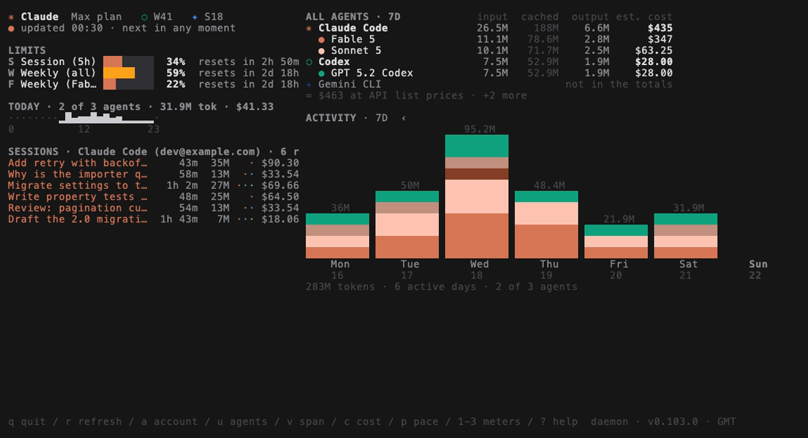
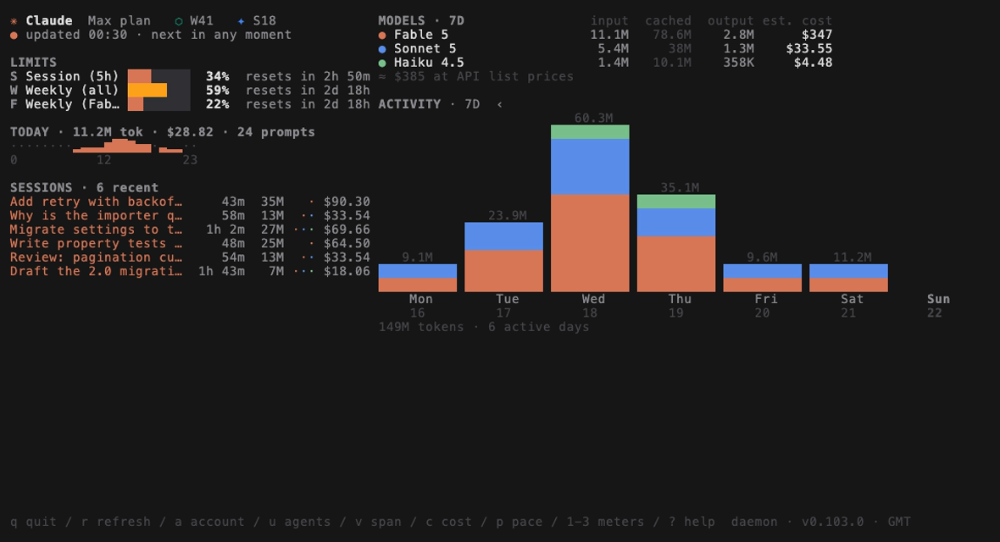
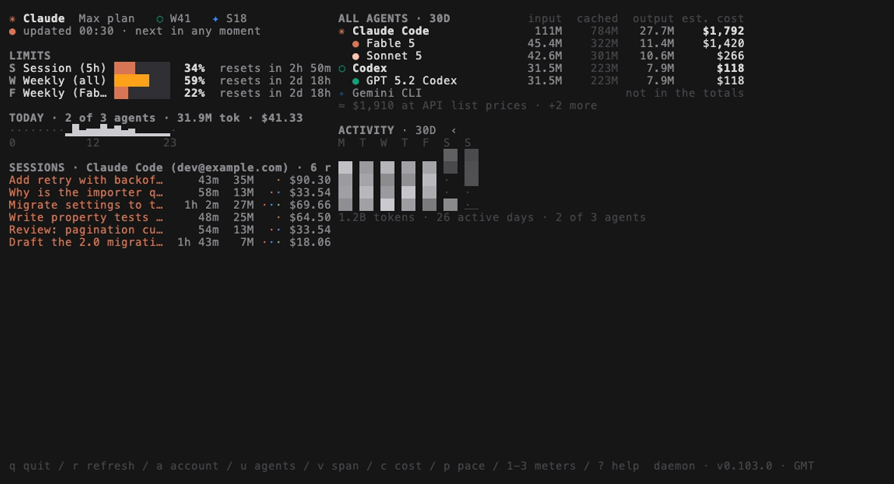
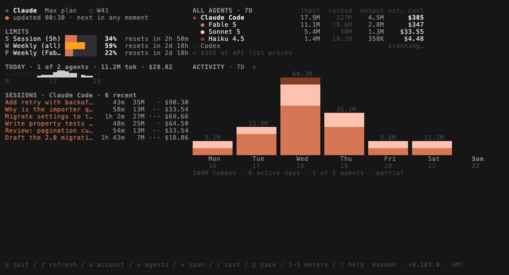

# The unified reading in the TUI and usage-cli

Branch `feat/tui-unified-reading`, 2026-11-21. Follow-up to #37
([unified-consumption.md](unified-consumption.md)), which gave the app's
panel an "All agents" consumption scope and left the TUI and the CLI out:
"no CLI or TUI total yet, so no digest change". The person, of their TUI:
"doesn't the unified appearance appear in the TUI interface as well?", then
"add one more worker to bring the unified view to the tui as well".

Carried over from #37 unchanged: the default scope is All agents; the
outline is agent-first; hue = agent and tone = the family's ledger slot when
several agents share a chart; tokens are summed across vendors (different
tokenizers, noted); cost is summed, unpriced stays absent, never $0; dormant
accounts and hidden harnesses are out of "all"; limits are never summed.

## Where the merge runs: the composer, from raw scans

`MeteringDigest.compose` (core, pure) gains the all-agents section. It is
computed from each member's RAW consumption — its in-memory days, minute
timeline and price table, exactly what the app's panel merges — through the
same core functions the panel uses (`ConsumptionMerge.days`,
`ConsumptionMerge.pricing`). Re-summing the per-account digest rollups would
give the same numbers today, but as a second implementation; this is one.

- `ProfileSection` gains `consumption: SectionConsumption?` (days, timeline,
  pricing). The host fills it from the running engine once its first scan
  has landed (`UsageEngine.sessionsIndexed`, set in the same main-actor step
  that assigns `activity`), nil before that.
- `HarnessSection` gains the harness's `colorLedger` (the host loads it from
  its defaults domain, as each engine's publish already does).
- `LiveStateBuilder.build`'s activity half (today, days, modelDays,
  hourDays) is factored into one static function with a row-building
  closure; the per-account path keeps byte-identical output (proved by the
  existing goldens, unchanged), and the all-agents section runs the same
  function over the merged days.

## Who "all" is: one core rule

`ConsumptionMembership` (new, core): enrolled ∧ enabled ∧ not dormant ∧
harness shown. `showInMenuBar` is NOT part of it (that is the bar's rule,
`showsCell`). The app's `ProviderRegistry.consumptionMembers` calls it, the
composer calls it, and `usage-cli` calls it over a digest's
`profiles`/`harnesses`. A member is one of:

- `counted`: its scan landed and its traces carry tokens: in every sum;
- `scanning`: its engine has not started (launches stagger by the 180 s
  gate floor) or its first scan has not landed: named, left out, and the
  section is `partial`. Never summed as zero;
- `noTokens`: its harness reports no tokens (`UsageProvider.reportsTokens`,
  Gemini CLI): named, "not in the totals", prompts excluded (#37's rule).

## The digest field (additive)

`LiveState.allAgents: AllAgentsState?`:

```
allAgents: {
  members:    [{ profile, providerID, state: counted|scanning|noTokens }]   // strip order
  countLabel: "3 agents" | "2 of 3 agents" | "2 accounts"                   // phrased once, core
  partial:    Bool          // some member is scanning; the sums leave it out
  models:     [ModelRow]    // today's, per agent+model, heaviest first
  activity:   ActivityRollup // same shape as the top level's
}
```

- `ModelRow` gains `agent: String?` (provider id), set only on all-agents
  rows; nil (omitted) everywhere else, so every existing row encodes
  byte-identically. Rows are per AGENT + MODEL: one model used from two
  accounts of the same agent is one row (summed), and two agents' same id
  (`unknown`) stay two rows. No consumer ever splits a U+001F key.
- Colours: one agent in scope keeps the colours it wears everywhere
  (`ModelColorMath.rgb`); several paint each model in its agent's accent at
  the family's tone (`ModelColorMath.agentShade`). Slots come from the
  engine-seeded ledger, families from the PROVIDER's catalog (the engine
  seed's rule). One new core seam picks between the two; `ModelColorMath`
  itself is untouched (t199 is changing it: the digest consumes whatever it
  becomes).
- Hourly buckets: `activity.hourDays` covers the last 8 days only (the
  builder's documented retention), to keep the digest small. A drill past
  that says "no hourly data" (the existing labelled degrade). `todayHours`
  is always there.
- Published only when "all" holds two or more members. Absent means one
  account (the focused section IS the total) or a writer before this
  field. The CLI tells the two apart with the shared membership rule over
  the digest's own `profiles`/`harnesses`. The TUI offers the scope key
  only when the section is present. Reason: a single-account Mac (most
  installs) would otherwise carry a duplicate rollup that every status-line
  call decodes.
- `viewing(profile:)` and every other `LiveState(` construction carries the
  field through.
- Size budget: on the person's data shape (three agents), the section adds
  at most about 15% to the digest. Measured in the build and reported in
  the PR.
- Goldens: the harness fixture gains activity on its two live sections and
  therefore an `allAgents` section exercising `ModelRow.agent`, a scanning
  member and the colour rule. Regenerated with `UPDATE_GOLDENS=1 swift test
  --filter LiveState`, diff read. The single-harness golden is unchanged
  (one member). Rust decodes both. `mise run digest-freeze` against main.

## The app: same answer, through core

- `consumptionMembers` → `ConsumptionMembership`.
- `countLabel` → core (`ConsumptionInput.countLabel` calls it).
- Merged colours: the app keeps `ModelPalette` as its entry point (t199's
  per-appearance work lands there), but the ledger lookups in a merged
  scope use the AGENT'S own catalog for families. Today they use the
  globally active catalog (`ModelNames.catalog`), so a Codex model in the
  merged chart is filed under Claude's reading of its family. That grows
  a stray family in Codex's ledger and can tone it differently from the
  digest. This was found while planning: a #37 bug, fixed here by
  construction.
- Snapshots before/after (default and `--several` demos, dark and light):
  pixel-identical from the Activity section down. If the family fix moves
  a demo colour, the PR shows it and says why.

## The TUI

- `App.scope: AllAgents | Account`, default All agents (the app's
  fresh-install default), held for the run like `period` and `dimension`:
  the TUI writes nothing. It survives a focus switch (`adopt()` resets
  surfaces, not toggles). Key `u` (free: q r p a A 1-4 [ ] n x X v c s z ?
  are taken); the footer shows `u agents` only when `allAgents` is present.
  When the section is absent, the scope reads as the account and nothing
  changes from today.
- One accessor picks the rollup by scope (`allAgents.activity` or the top
  level's). `Dash::build`, `today`, `render_bars`, `render_heatmap`,
  `activity_readout` and `render_day` read through it, so no form forks.
- MODELS, All agents: the agent ▸ model outline. Agent rows wear the
  agent's glyph in its accent (identity from `harnesses[]`), with summed
  columns. Model rows are indented, with the agent-shaded dot. Ordering is
  heaviest-first at both levels, prompt-only and scanning agents last, as
  `ConsumptionOutline` orders. A `scanning` agent keeps a dim row,
  "scanning…"; a `noTokens` agent keeps a dim row, "not in the totals".
  The title reads `MODELS · All agents · 7D`. The rollup line counts
  unpriced models and "+N more".
- Degrade, documented in TUI.md: every agent row is seated first, then
  models fill the remaining seats heaviest-first under their agents. With
  no seat to spare it is agent rows only, "+N models" in the rollup line.
  Narrow panes use the existing narrow columns (tokens + cost), and under
  ~30 columns the indent shrinks to one cell. No family fold on All (the
  app folds; the pane has no room; noted as a deliberate difference).
- Hover/focus: a model row highlights its own (agent, id); an agent row
  highlights all of its models (the filter becomes a key set). Bars dim the
  rest, the heatmap re-ramps to the set, and the readout names it.
- ACTIVITY stacks per agent+model in the digest's colours, in outline
  order (agent by agent, heaviest at the bottom). The heatmap ramp and the
  TODAY spark go neutral when agents share them (the app's
  `Color.primary` rule).
- TODAY: totals and hours across agents. The title carries the count label
  when it fits ("TODAY · 3 agents · 2.1B tok · $815 · 696 prompts"):
  prompts drop first, then the label. The readout under ACTIVITY appends
  the count label, and "partial" while a member scans.
- The header keeps the focused account's limits. Limits are never summed.
  SESSIONS stays the focused account's list, and in All agents its title
  names that agent so it can't be misread. Merging the shortlist is a
  follow-up.
- The day drill in All agents reads the all-agents rollup (per agent+model
  rows, hours within 8 days).
- Safety fix needed to verify at all: an explicit `--digest <file>` never
  runs `usaged ensure`, and talks to no socket unless `--socket` is also
  given. The CLI has the same rule: "`--digest <file>` asks no engine".
  Today a demo digest that ages past the heartbeat horizon reads as offline
  and spawns `usaged ensure`, which can repoint the live launch agent, and
  keys like `a` or `r` reach the live engine.

## usage-cli

- `--all-agents` (boolean), registered in `flagOwners` for `activity`,
  `cost`, `models` and `model`; anywhere else it is exit 19 "unknown flag".
  It answers by projecting `allAgents` onto the top level's
  `activity`/`models`, then running the existing noun code.
- With `--account` or `--provider` it is exit 19 (a contradiction). The
  home variable (`CLAUDE_CONFIG_DIR`) is ignored under it.
- Section absent: if the membership rule finds one member or none, that
  account's section answers (the total of one account is the account). If
  it finds two or more, the writer predates the field: exit 20, "this
  digest carries no all-agents total (an older writer)".
- Rows: JSON carries `agent`. `--raw` appends `agent` as the last column
  (only these rows have one). The human table leads with the agent's short
  name. `model <sel> --all-agents` selects across agents; an id two agents
  share is exit 19 "ambiguous", as today. A new `model` field, `agent`, is
  walked in the catalog tests. `aggregateModels` keys by (agent, id).
- Partial: stdout unchanged in raw/JSON, a stderr note in every register
  ("partial — Codex still scanning"), and the human line ends
  "· partial". Exit 0.
- Every existing invocation is byte-for-byte unchanged, exit codes
  included (the existing suites hold this).

## Tests

- Core: membership (strip rule, `showInMenuBar` ignored, dormant, hidden
  harness, disabled); the all-agents builder (disjoint and overlapping
  model names, one model across two accounts of one agent, unpriced →
  nil cost and counted, scanning member left out and `partial`, `noTokens`
  member named and out of every sum, today fields, the 8-day hours cap,
  colours for one agent vs several, families by provider catalog); ONE
  answer: the section's day tokens/costs equal `ConsumptionMerge` +
  `CostIndex` over the same accounts, and equal Σ counted members'
  per-account rollups (parts sum to the whole); per-account output
  byte-identical after the builder refactor (goldens); projections carry
  the field.
- CLI: each noun with `--all-agents` in all three registers; contradiction
  19; inapplicable noun 19; absent section with one member (answers) and
  with two (20); the `agent` field walk; existing outputs unchanged.
- Rust: golden decode of `allAgents` and `ModelRow.agent`; outline
  arrangement and seat degrade; scope key toggling, hidden without the
  section, kept across a focus switch; the filter as a key set; `--digest`
  never ensures.
- Demo: `demo-digest.py` starts from the harness golden, so it must rebuild
  `allAgents` from its own synthesized sections (the colours are
  `ModelColorMath.agentShade` outputs for the demo's ledgers, computed once
  in Swift and pasted, with a note). A jq check asserts Σ members' day
  tokens = the section's.

## Verification

- First act of the build, before any edit: one saved demo digest
  (default and `--several`), panel snapshots (dark and light), TUI captures
  at 100×27, 46×30, 72×16 and 46×8, and the current `activity`/`models`/
  `cost` outputs and exit codes, all from the untouched tree.
- After: `usage-tui --digest <demo> --status`; real screen captures with vhs
  (as `scripts/media.sh` does) and tmux `capture-pane` at the standard
  sizes plus a narrow one, both scopes; the panel via `--snapshot` with
  `--demo-digest`, compared pixel-for-pixel. Every TUI run passes
  `--digest` and a scratch `--socket`, on a freshly written demo; never
  `mise run tui`, never the live install.
- `mise run gate` green; `mise run digest-freeze` against main.

## Overlaps

- t199 `fix/activity-table-padding` (colour math, panel outline padding):
  this branch never edits `ModelColorMath` or `ConsumptionOutlineGrid`;
  the digest consumes the math. Rebase onto it if it lands first.
- t198 `fix/daemon-under-load` (`activityStatus`, absent activity while
  scanning): `scanning` here is the same idea, inside this section. On
  rebase the member state reads t198's marker instead of `sessionsIndexed`
  (a `cached` member is counted and the total says "as of").
- t197 `fix/antigravity-zero-setup`: digest only.

## Docs

TUI.md (scope key, outline, degrade, `--digest` rule), TUI-PARITY.md (a
parity entry), CLI.md (`--all-agents`), DAEMON.md (`allAgents`, `ModelRow.agent`),
CHARTS.md ("The consumption scope": the total is now in the digest),
unified-consumption.md (follow-up done), `.release-notes/next.md` (a New
entry, appended).

## Build notes (where the build moved off the plan)

- The outline's title is `ALL AGENTS · 7D`, not `MODELS · All agents · 7D`:
  the longer title left no room for the column labels over their columns,
  and the shorter one names the scope as plainly.
- The composer's section is memoized on the host (`AllAgentsCache`): every
  engine landing republishes, heartbeats included. Measured ~127 ms per
  build in a DEBUG build on heavy synthetic data (four accounts' worth of
  366 days and ~97k timeline slots). Unchanged scans now cost an equality
  check of buffers that compare by identity first.
- Size on the person's data shape (estimated from the live digest's three
  counted accounts, read-only): ~111 KB pretty, +16.7% on a 664 KB digest,
  a little over the ~15% budget. The bulk is the 35 days of per-model rows.
- TODAY's title now fits itself to the pane in BOTH scopes: it drops the
  prompt count, then the agent count. At 72×16 the focused-account view
  used to clip "· 23 prompts" to "· 23 prom".
- An agent row whose full name won't fit shows its short name.
- The rollup's tail reads "+N more", not "+N models": it counts hidden
  agent rows too.

### After the review round (three independent reviewers)

- NO TOTAL YET: while no member is counted, the section carries no
  `models`/`activity` (absent, not zeros). The CLI answers 20 with a note;
  the TUI's TODAY and readout say so. A Mac with every account disabled
  or asleep is 20 under `--all-agents` too, not the focused numbers.
- The memo keys on where each horizon's cut falls as well as the day: a
  `now − 35 days` cut crosses a midnight an hour off local midnight across
  a DST change, so the memo could keep a day the per-account sections had
  dropped. Tested in Zurich's spring-forward.
- The 8-day hours cap is a SIZE cap, not the scanner's retention (56 days
  since v0.91.0); the stale "~8 days" comment and CLI note are corrected,
  and a drill or `hours` call past it says why.
- TUI: hover and the cursor hold a row by its id (a scan landing above it
  moved the cursor onto another row); MODELS gives back rows down to one
  rather than cost the activity chart (46×22 and 90×13 lost it);
  "partial" is the last word a narrow readout gives up; `AGENTS · 7D`
  where `ALL AGENTS` would push the labels out; noted agent rows dim;
  charts go neutral only when several AGENTS share them (the app's
  `spansAgents`); the drill names its scope and disambiguates twin model
  names; `u` clears the old hit map; keys that would talk to an engine
  in a `--digest` pane say there is none. The TODAY and MODELS renderers
  moved to `tui/src/ui/consumption.rs` (ui.rs had grown past 3000 lines).
- The demo script fails on an unpasted agent shade instead of falling
  back, asserts its section is the plain sum of its counted sections,
  empties a scanning Codex's own section, and refuses a flag-shaped path.
- NOT changed, follow-up: the app panel has no "scanning" state, so an
  account mid-first-scan counts (as nothing) there while the digest says
  `scanning`/partial — #37's behaviour; the fix is a panel state in
  `ConsumptionOutlineGrid`, which PR #41 is editing. The composer runs on
  the host's actor on a memo miss (one per scan landing); moving it off
  the actor is a follow-up if the daemon's load work wants it.

## Captures (demo data, vhs)

All agents, 7D (`demo-digest.py --several`: a second Claude account summed
under Claude Code, Gemini CLI named and not counted):



After `u` — the focused account, as before:



All agents, 30D — the neutral heatmap:



A member still scanning (`demo-digest.py --scanning`): named, left out, "partial":


