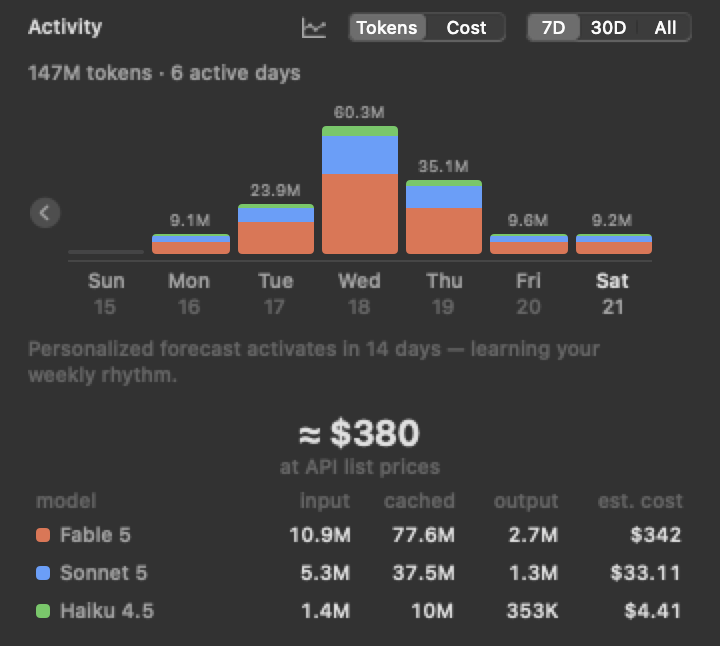
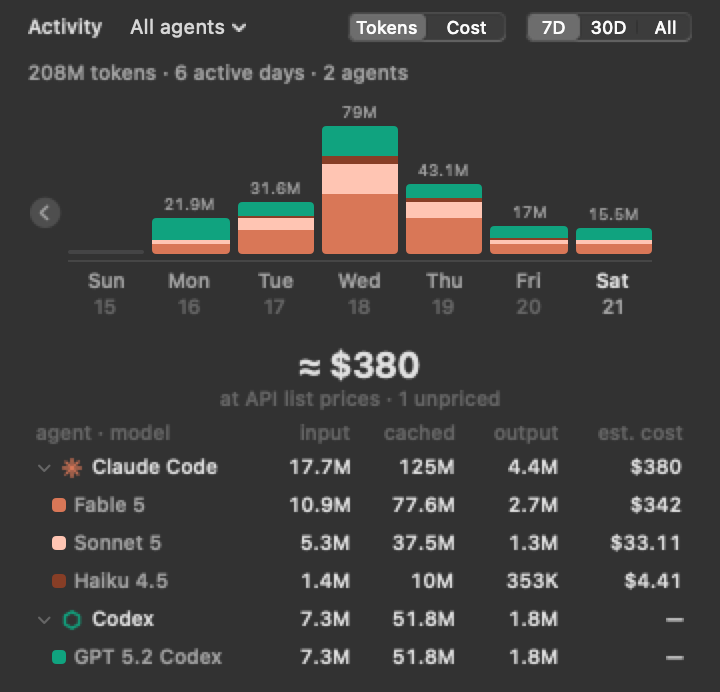
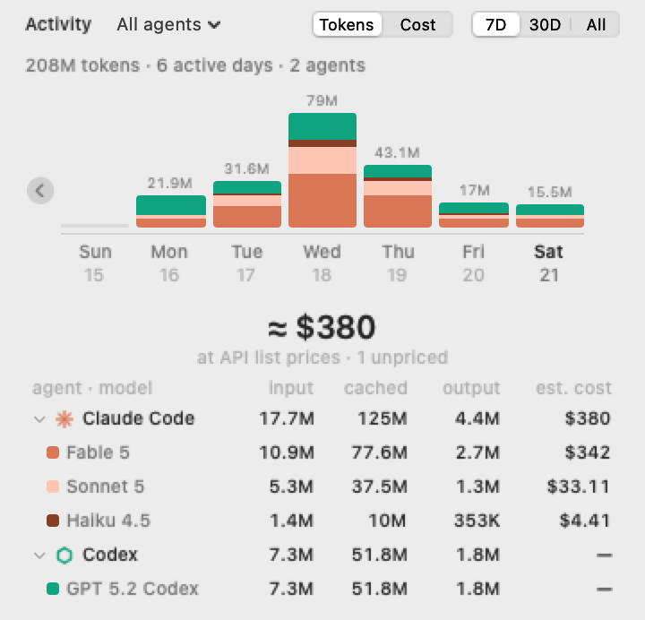
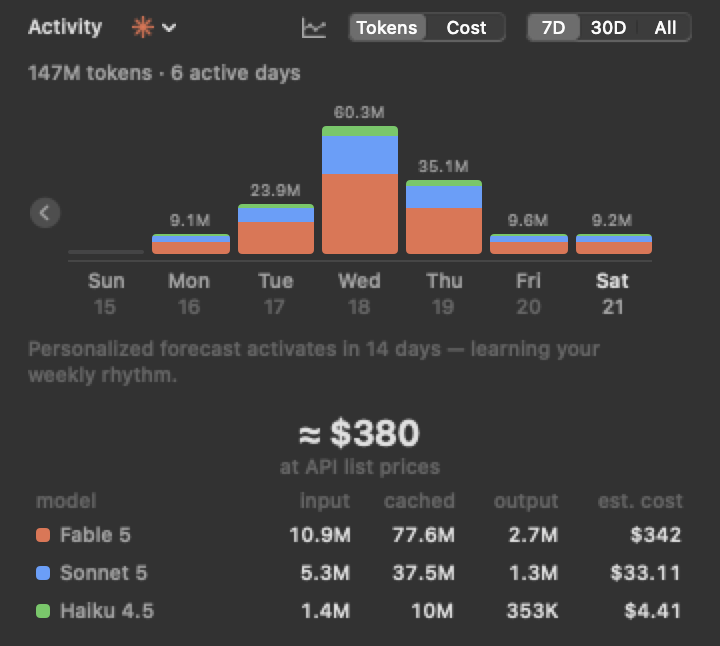
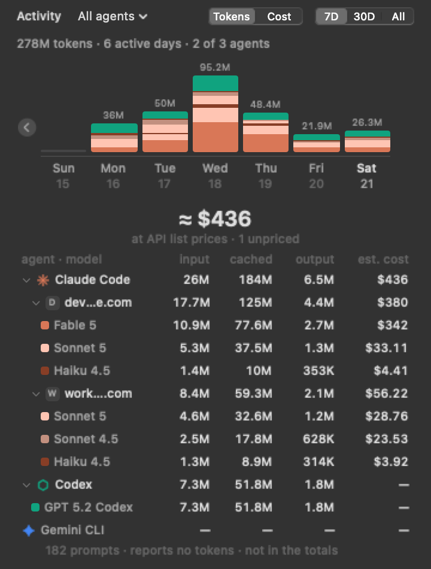
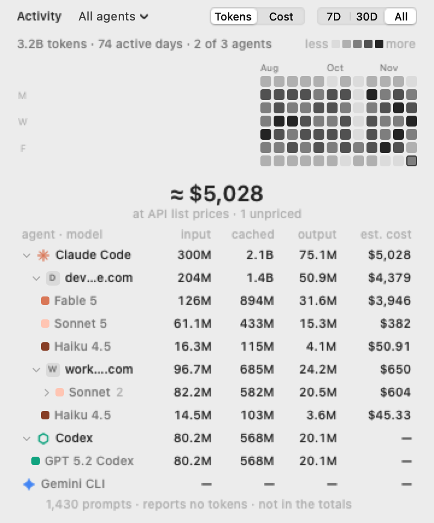

# One consumption reading across every agent

Branch `feat/unified-usage-reading`, 2026-11-21. Design exploration first
(mocks), then this change. The chart rules it settled live in
[CHARTS.md](../CHARTS.md#the-consumption-scope); this file keeps the why.

## What was asked

In the user's words, after a first pass that joined limits and tokens
inside one account:

> I want to be able to see in this section the consumption of all the
> different agents and all their different models. I want to see a total
> of claude and codex together for instance where I see token and cost
> consumption. This might require introducing new concepts and separating
> concepts to make sure we do it in a way that makes sense. Because a
> unified limit will not make sense because they don't tap from the same
> models. But for consumption it makes sense to allow a unified view
> because these can be aggregated.

And, of the first pass: "your idea of consolidating models by type (all
sonnet, all opus, etc.) is a good idea that I think we should preserve and
later expand upon."

Three directions were mocked (scope of the section; agent chips over one
flat model ledger; separate Limits | Consumption zones). The user picked
the first: "All agents" is a scope of the existing Activity section.

## Concepts introduced or pulled apart

- **Consumption scope ≠ focus.** Focus decides whose limits lead the bar
  and the panel; the scope decides whose consumption is counted. One
  switch used to do both.
- **Agent, account, model are three axes.** An agent holds accounts; the
  breakdown says which axis it groups by first (agent).
- **What adds up.** List-price cost: yes, each model priced by its own
  harness. Tokens: yes, as each vendor counts them. Prompts, active days
  (union): yes. Limit percent: never. An agent with no token data: named,
  not summed.
- **A cross-agent colour rule.** Hue = the agent's accent, tone = the
  model family's persistent ledger slot.
- **Per-account readings step aside** in a merged scope: the typical-week
  line and the limit-window views are one account's limit history.

## Decisions

| # | Question | Decision |
|---|---|---|
| 1 | Default scope | All agents, persisted (`activityScope`), independent of focus. |
| 2 | Who is in "all" | The strip's accounts minus hidden harnesses. Dormant accounts out (user-confirmed): no engine while the app hosts, so including them needs a scan and makes the total role-dependent. |
| 3 | Agent-first or model-first | Agent-first outline: agent ▸ account ▸ model, each level only where it says something. |
| 4 | Colour rule | One agent: today's colours. Several: agent accent × family tone from the ledger; fixed per model. |
| 5 | Tokens across vendors | Summed, like cost (asked for both); a tooltip names the tokenizer caveat. |
| 6 | Sessions | One merged strip in the panel; the Sessions window stays per account. |
| 7 | CLI / TUI | Not in this change: no digest field. |
| 8 | Outline defaults | Agent and account rows open (user-confirmed: they are the bars' legend); on All, versions fold by family. |

## Design

- Core: `ConsumptionScope` (raw-value persisted, falls back to all without
  writing), `ConsumptionMerge` (days summed one entry per day under
  `agent␟account␟model` keys, per-harness composite pricing, merged
  sessions newest-first), `ConsumptionOutline` (the tree, honest costs,
  family fold), `ModelColorMath.agentShade`, `UsageProvider.reportsTokens`.
- App: `ProviderRegistry+Consumption` (members, scope stores, memoized
  merged input, colours), `ActivityScopeMenu`, `ConsumptionOutlineGrid`,
  `HeatmapView`'s optional merged mode, the panel split into a focus-keyed
  and a scope-keyed subtree, owner-routed session clicks.
- No new scan, file or network destination: every account already scans
  itself; the merge is arithmetic over what is in memory.
- Found on the way and fixed first: a `--demo-digest` run grew the LIVE
  install's model colour ledger (a dev bundle shares its defaults domain).

## Snapshots (demo data)

Before — the focused account only:

After — all agents, 7D, dark and light; Codex is unpriced in a demo (its
bundled price table is empty), so it reads "—" and is counted, not valued:

Narrowed to one agent — today's section, with the typical-week caption and
the audit toggle back:

A second Claude account and Gemini CLI (`demo-digest.py --several`): the
account level, distinct version tones, the prompt-only agent:

All period: the neutral heatmap and the family fold ("Sonnet 2"):

The demo digest carries ~35 days of per-model tallies but ~12 months of
day totals, so on All the outline sums sit below the headline tokens in
these pictures; a real scan has both for every day.

## Follow-ups

- The Sessions window's own scope ("Show more…" still opens the focused
  account's window).
- The cross-agent total in the digest, so `usage-cli` and the TUI report
  it (an additive field; goldens on both sides).
- The family view at every period, and one family total across agents
  once a model line is reachable through more than one.
- The main window's Home page (feat/main-window): consumption as tiles
  answering for every agent.
- Regenerate the README media (`mise run media -- app`) once released, so
  the picture shows the merged section.
